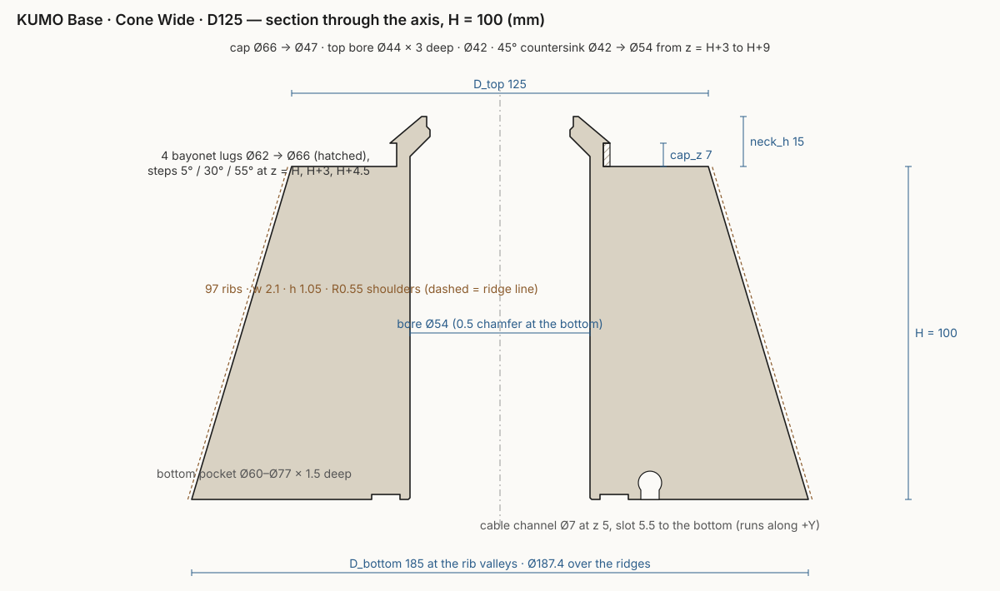

# KUMO base, cone wide, D125: a parametric rebuild

A test of Forma's engine as a reverse-engineering tool: one object out of a nine-object
Bambu Studio 3MF (`KUMO - Base - Cone Wide - D125 - Collection.3mf`, lamp bases H50 … H175)
was measured from its mesh and rebuilt as a parametric SolidCraft design with 33 named
parameters. Changing `H` in the Parameters panel reproduces the whole family.

## Open it in Forma

https://studio.artea.ro/forma/?open=/forma/designs/kumo-base.sc opens the saved design straight in
the browser app (the Pages workflow copies `kumo-base.sc` to `/forma/designs/`); the body comes from
the file's cache, so it is on screen in seconds, and the parameters are live.

## Files

| File | What it is |
|---|---|
| `kumo_commands.json` | The 89 engine commands that build the part (parameters, sketches, revolve, sweep, patterns, cuts). Replay in the browser console on studio.artea.ro/forma: `const {commands} = await (await fetch('kumo_commands.json')).json(); for (const c of commands) await solidcraft.execute(c.command, c.params)` |
| `build2.cjs` | The Playwright script that drove the live app to build and measure the part (`node build2.cjs`; `FAMILY=1` also checks H = 50 and 175) |
| `export.cjs` | Replays `kumo_commands.json` and downloads the design as `.sc`, `.3mf`, `.step`, `.stl` |
| `kumo-base.sc` | The saved design, with its geometry cache |
| `section.py` → `section.svg` | The dimensioned section drawing above |

## Measurements (mm, Z up, from the H100 mesh; all nine variants agree)

| Feature | Measured | Parameter(s) |
|---|---|---|
| Cone, at the rib valleys | Ø185.0 at z 0 → Ø125.0 at z H | `D_bottom`, `D_top`, `H` |
| Over the ridges | +1.1 radial at H100 (rib height 1.054 square to the slant) | `rib_h` |
| Ribs | 97, ~2.1 wide, ~1 mm flat top, R≈0.55 shoulders, flat valley | `ribs`, `rib_w`, `rib_r` |
| Through bore | Ø53.9 ≈ 54, 0.5 chamfer at the bottom | `bore`, `bore_chamfer` |
| Countersink | 45°, Ø54 → Ø42, z H+3 … H+9 | `cs_start`, `cs_depth` |
| Cap bore | Ø42 to z H+12, Ø44 for the top 3 mm | `hole_top`, `top_bore`, `top_bore_depth` |
| Neck | Ø62 cylinder, z H … H+7 | `neck_d`, `cap_z` |
| Bayonet lugs | 4, Ø62 → Ø66; steps 0–4° (z H…H+3), 0–29° (H+3…H+4.5), 0–54° (H+4.5…H+7) | `lugs`, `lug_t`, `lug_a1..3`, `lug_z2`, `lug_z3` |
| Cap | cone Ø66 at z H+7 → Ø47 at z H+15 | `cap_d`, `cap_top_d`, `neck_h` |
| Bottom pocket | annulus r 29.9 … 38.5, 1.5 deep | `pocket_d1`, `pocket_d2`, `pocket_depth` |
| Cable channel | along +Y, Ø7 centred at z 5, slot 5.54 wide open to the bottom, bore → rim | `chan_d`, `chan_z`, `chan_slot` |

Total height is always H + 15.

## How it is built

1. One closed profile in the YZ plane (13 points, all expressions), `solid.revolve` → `Base`.
2. Rib profile sketched on a plane square to the cone slant (`construct.plane.along_path`),
   `solid.sweep` along the slant, `solid.pattern.circular` × `ribs`, `solid.combine` join.
3. Three sector sketches on offset planes at z = H, H + `lug_z2`, H + `lug_z3`, extruded and
   joined, `solid.pattern.circular` × `lugs`.
4. Annular pocket and the keyhole channel as `solid.extrude` cuts.

## Validation

| | Original mesh | Rebuild | Error |
|---|---|---|---|
| Volume, H100 | 1712.827 cm³ | 1712.923 cm³ | +0.006 % |
| Volume, H50 (ribs only, v1 model) | 863.661 cm³ | 869.41 cm³ | +0.67 % |
| Profile radii at 20 heights | | | ≤ 0.06 mm |

Left out on purpose, all under a millimetre: the ~1 mm rounds where the ribs meet the top and
bottom faces, four 55° notches in the Ø42 bore between z H+11 and H+12.5, and the 0.5 chamfer
along the channel slot.

Original volumes for reference: H50 863.661, H60 1033.391, H70 1203.198, H80 1373.076,
H90 1542.926, H100 1712.827, H125 2137.643, H150 2562.528, H175 2987.433 cm³.
